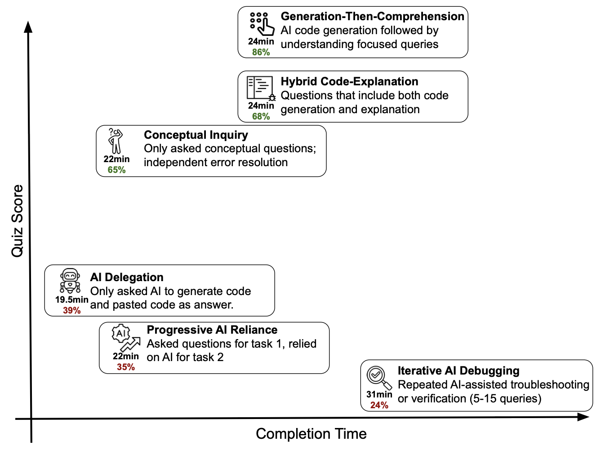

# ACRG AI Principles: Supporting Documentation

**Version 0.1 (draft) — August 2026**

An annotated list of the evidence and precedents that informed the principles and guidelines. This is not a systematic review; it is a set of sources that informed our discussions, with notes on what each contributes. Group members are encouraged to add to it, especially with critical perspectives.

## Evidence on productivity, expertise, and skill (informs Principles 1, 2, 6, 7, 8)

Some headline patterns across this literature: on well-scoped tasks within AI's competence, less experienced people gain the most; the main advantage of the human expert is not increased productivity but the ability to detect where the tool's competence ends and the ability to verify its output. However, self-reported productivity gains are unreliable. Furthermore, gains measured at the individual level can reverse at the collective level: assistance can lift each person's output while narrowing the diversity of what a group produces. It can speed up today's work while, if used without scrutiny, slowing the formation of tomorrow's expertise.

A standing caveat for everything in this section: these studies measure particular tool versions at particular moments, and the field is moving faster than the publication cycle. Several are already one or more model generations old. We treat them as evidence about broad patterns (who benefits, where the risks sit), not as settled measurements of what current tools can do, which is itself an argument for evaluating our own practice rather than relying on published numbers.

- **Brynjolfsson, Li & Raymond, "Generative AI at Work", *Quarterly Journal of Economics* (2025).** First large-scale field study (~5,000 customer-support agents): ~15% average productivity gain, concentrated in novice workers (~34%), with minimal gains for the most experienced. https://doi.org/10.1093/qje/qjae044 (working-paper version: https://doi.org/10.3386/w31161)
- **Dell'Acqua et al., "Navigating the Jagged Technological Frontier: Field Experimental Evidence of the Effects of Artificial Intelligence on Knowledge Worker Productivity and Quality", *Organization Science* (2026; the "BCG study").** Preregistered experiment with 758 consultants: within the AI frontier, AI users completed 12.2% more tasks, 25.1% faster, at significantly higher quality; on a task outside the frontier, AI users were 19 percentage points less likely to produce correct solutions than unaided subjects. The core evidence for "verification is the scarce skill" — though the outside-frontier result rests on a single task, a limitation the authors themselves flag. https://doi.org/10.1287/orsc.2025.21838
- **Noy & Zhang, "Experimental evidence on the productivity effects of generative artificial intelligence", *Science* (2023).** Writing tasks; largest gains for weaker writers; inequality-reducing on measured output. https://doi.org/10.1126/science.adh2586
- **Peng et al., "The impact of AI on developer productivity: evidence from GitHub Copilot" (arXiv, 2023).** ~56% faster task completion, larger benefits for less experienced developers. https://arxiv.org/abs/2302.06590
- **Vaccaro, Almaatouq & Malone, "When combinations of humans and AI are useful: a systematic review and meta-analysis", *Nature Human Behaviour* (2024).** Across ~100+ studies, human–AI teams often underperform the best of either alone; gains are most reliable for lower performers on well-defined tasks. Notably for us, the effect splits by task type: creation tasks showed performance gains, while decision tasks showed performance *losses*. Suggests caution needed for judgement-heavy work. https://doi.org/10.1038/s41562-024-02024-1
- **Becker, Rush, Barnes & Rein, "Measuring the impact of early-2025 AI on experienced open-source developer productivity" (arXiv, 2025; METR).** Experienced developers working on their own repositories were ~19% *slower* with AI assistance, while believing they were ~20% faster. The key caution against testimony, including our own. Treat the effect size, not the lesson, as dated: the study used early-2025 tools, and the authors noted preliminary signs that the then-newest models were already handling some tasks more capably. https://arxiv.org/abs/2507.09089
- **Doshi, A. R. & Hauser, O. P., "Generative AI enhances individual creativity but reduces the collective diversity of novel content", *Science Advances* (2024).** In creative-writing experiments, AI assistance improved individual output on average, but made outputs more similar to each other. As the Brookings piece summarises it (below): AI lifts the average and narrows the variance. The only study here measuring a *collective* effect, and the most direct evidence for Principle 8: if a whole group prompts the same models, priors correlate even when every individual output looks good. Individual-level evaluation (time, error rates) will not see the diversity loss. https://doi.org/10.1126/sciadv.adn5290
- **Shen, J. H. & Tamkin, A., "How AI Impacts Skill Formation", arXiv:2601.20245 (January 2026).** Randomized controlled trial: 52 junior developers learning a new Python library; the AI-assisted group scored 17% lower on comprehension (largest gap: debugging) without finishing significantly faster. Encouragingly, three of the six AI interaction patterns identified — those involving active cognitive engagement — preserved learning outcomes, which points to *how* AI is used mattering more than *whether*. The most direct evidence for Principle 7. Note the limitations the authors state (small sample; comprehension tested immediately, not months later; sidebar assistant rather than agentic coder, with effects expected to be larger for the latter) and the provenance: the study was conducted by Anthropic researchers, the same company whose model co-authored these documents. https://arxiv.org/abs/2601.20245

  

  *Figure 11 from Shen & Tamkin (2026), reproduced under CC BY-NC-ND 4.0. The six AI interaction patterns and their associated learning outcomes — the patterns involving active cognitive engagement preserved learning even with AI assistance, while delegation-heavy patterns did not.*
- **Brookings Institution, "Borrowed expertise: why AI's productivity boom may not survive the generation that built it" (July 2026), and companion piece "Repaying the inheritance: how education and research policy can address AI's borrowed expertise".** Argues current gains draw down a stock of expert judgement being replenished more slowly than it is spent, citing payroll-record evidence (Brynjolfsson, Chandar & Chen) of firms cutting junior hiring while growing senior ranks. This is a collective-action failure: every firm's senior experts were trained by junior work done somewhere, so each firm has an incentive to free-ride on the training done by others. The first piece notes that developmental work is invisible in the work product; an assisted and an unaided junior turn in indistinguishable memos, so any measurement based only on the output reads the unaided slog as waste. Instead, this slog is what builds the person who can later fine the flawed argument in someone else's work. The systemic version of the skill-formation concern; the companion piece addresses education and research policy responses directly. https://www.brookings.edu/articles/borrowed-expertise-why-ais-productivity-boom-may-not-survive-the-generation-that-built-it/ and https://www.brookings.edu/articles/repaying-the-inheritance-how-education-and-research-policy-can-address-ais-borrowed-expertise/

## Policy precedents and analyses (inform the three-layer structure)

- **Open-source AI contribution policies — curated collection (M. Weissman de Mello / melissawm, GitHub).** Dozens of real project policies, from full acceptance to prohibition. Source of the provenance taxonomy (implemented/assisted/advised) and the anti-"slop" norms. This is perhaps the closest analogue to a research group's code practice. https://github.com/melissawm/open-source-ai-contribution-policies
- **HEPI Policy Note 71, "What UK university AI policies actually do: a study of 96 institutions" (May 2026).** A rigorous analysis of UK higher education institutional policies. Its focus is almost entirely on AI in education and academic misconduct; institutional policies say relatively little about AI in *research*. That silence is itself the finding that matters to us as it confirms the gap these principles exist to fill. However, its broader observation about the distance between what policies say and the work they perform remains a warning for our own work. https://www.hepi.ac.uk/wp-content/uploads/2026/05/What-UK-university-AI-policies-actually-do-A-study-of-96-institutions.pdf
- **Cornell University, "Generative AI in Academic Research: Perspectives and Cultural Norms" (task-force report, December 2023).** The institutional example closest to what we are attempting. The task force explicitly frames its output as "peer-to-peer guidelines, not a suggestion of any formalized university policy". It is internal advice written by active researchers, with authority derived from that rather than from a compliance office. It is organised across the research lifecycle (conception and execution, dissemination, translation, funding) rather than around misconduct, and so covers the pre-publication months. Its appendix of "discussion starters" is explicitly designed to seed norm-setting conversations within individual research groups, which is roughly the function we hope this repository serves. https://research-and-innovation.cornell.edu/generative-ai-in-academic-research/
- **ICMJE authorship criteria.** The pre-existing standard (substantial contribution + accountability) that survives AI contact and underpins Principle 4. AI tools do not meet the criteria for authorship; humans who meet them remain authors regardless of tools used. https://www.icmje.org/recommendations/browse/roles-and-responsibilities/defining-the-role-of-authors-and-contributors.html
- **Journal and publisher AI policies (Nature portfolio, Science, and most major publishers).** Converged position: disclose use; AI cannot be an author; human authors are accountable. These govern the point of submission; our principles govern everything upstream.

## Context and further reading

- **"Borrowed expertise" (Brookings, 2026), on Kuhn's normal-science/paradigm distinction.** The cited successes of AI in science (e.g., AlphaFold, materials discovery, etc.) are cases where humans have already framed the problem cleanly and AI does powerful *normal-science* work within the frame: recombinatorial, cumulative, mostly successful. The wins are real, but they are not the whole story. The frame is exactly what a group's judgement supplies, and what erodes if the skills that build it aren't practised (Principles 6–8). https://www.brookings.edu/articles/borrowed-expertise-why-ais-productivity-boom-may-not-survive-the-generation-that-built-it/
- **HEPI Student Generative AI Survey (2026).** UK students overwhelmingly view AI capability as essential and feel under-supported. This is context for Principle 2's support commitment. https://www.hepi.ac.uk/reports/student-generative-ai-survey-2026/
- **Open-source maintainers on AI-generated contribution quality ("AI slop").** The clearest documentation of the generation/verification imbalance at community scale is not an analysis but the policies themselves: dozens of projects have independently converged on rules whose explicit premise is that review effort is the binding constraint. Curl's policy states it directly: "a contribution should be worth more to the project than the time it takes to review it". Similarly, FastAPI's: "if the human effort put in a PR... is less than the effort we would need to put to review it, please don't submit the PR." The field-level version of the concern behind Principle 6. (Both quoted via the open-source policies collection above; see also GitHub's own discussion of low-quality AI contributions: https://github.com/orgs/community/discussions/185387)

## Notes on this document

- Citations were assembled with AI assistance and have each been verified against the published source by a human author (August 2026; Principle 3 applies to bibliographies too). New additions should be verified the same way before being merged.
- The evidence base here is weighted toward studies of professional work; direct evidence from research science is thin. This is a reason for our commitment to scrutinising our own practice rather than relying on analogy.
- This list should include the strongest *critical* perspectives on AI in science, which are currently under-represented here. Contributions welcome, particularly since one of this document's co-authors has a declared conflict of interest on exactly this point.

---

*Authors: Matt Rigby and members of the ACRG, with Claude (Anthropic) and Kimi (Moonshot AI). Assistance level: agent-implemented, verified against published sources by the human authors.*
